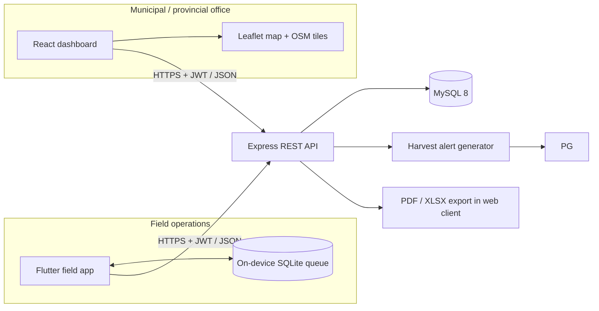
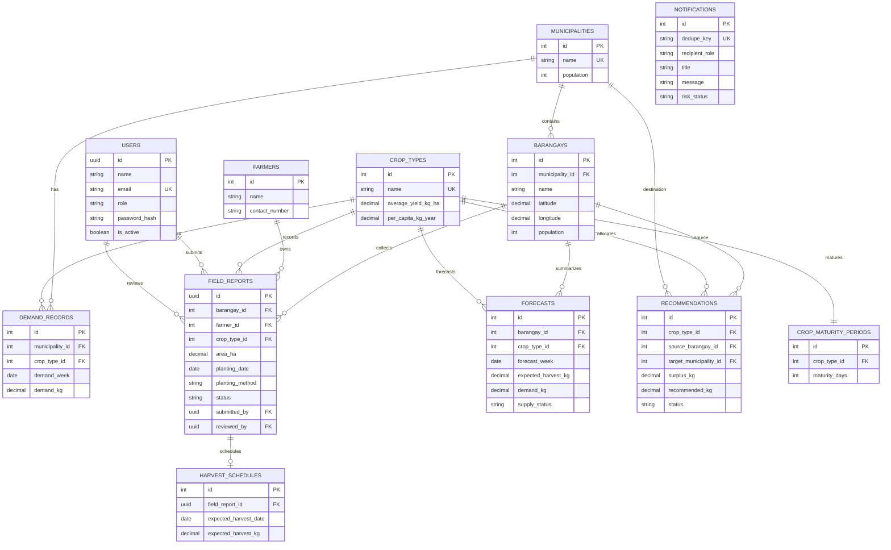
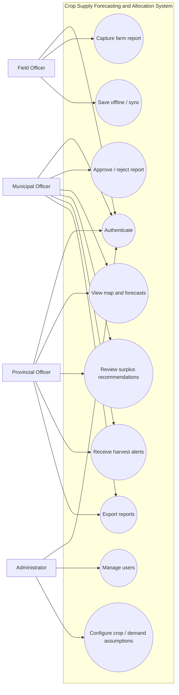
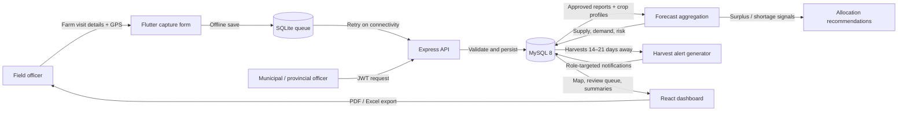

# AgriCast system design

## 1. System architecture



The web and mobile clients share the API and MySQL model. The mobile app stores drafts and submitted-but-unsynced reports in SQLite. On connectivity restoration it retries queued submissions; the API is the source of truth after a successful response. MySQL triggers write record-level changes to `audit_logs`; the API polls that table and streams new change metadata to authenticated dashboard clients over server-sent events, so the existing report and forecast views refresh without a page reload. Leaflet uses OpenStreetMap tiles. The map loads the 61-feature Boac barangay GeoJSON layer at `frontend/public/data/boac-barangay-boundaries.geojson`, sourced from NAMRIA administrative boundaries valid on 2023-11-06 and cross-referenced to the PSA PSGC 2023-10-24 snapshot. Stored map coordinates are checked against the assigned polygon; absent or invalid coordinates use an interior representative point, which is a barangay-level visualization point and not a farm GPS fix. Boundaries are simplified at 0.005° and must be confirmed with current LGU/NAMRIA GIS before legal or cadastral use.

The current schema synchronizes field reports and their derived harvest schedules/forecasts, crop reference data, allocation recommendations, and in-app notifications. It does not yet model weather-provider forecasts or dedicated pest/disease reports and announcements; adding those domains requires approved data fields and workflows rather than storing them in unrelated existing tables.

## 2. Database ERD



## 3. Use case diagram



## 4. Data flow diagram



## 5. UI wireframes

### Web dashboard

```text
┌─────────────────────┬──────────────────────────────────────────────────────────┐
│ AgriCast │ Workspace > Dashboard Search ● AM │
│ Boac Municipality   ├──────────────────────────────────────────────────────────┤
│                     │ Good morning, Alex                   [+ New field report]│
│ OVERVIEW            │                                                          │
│ ▸ Dashboard         │ ┌───────────┐ ┌───────────┐ ┌───────────┐ ┌───────────┐ │
│   Map view          │ │ Harvest   │ │ Area      │ │ To review │ │ Barangays │ │
│ OPERATIONS          │ └───────────┘ └───────────┘ └───────────┘ └───────────┘ │
│   Field reports     │ ┌────────────────────┐ ┌───────────────────────────────┐ │
│   Forecasting       │ │ Harvest outlook    │ │ Production by barangay (map)  │ │
│   Supply allocation │ └────────────────────┘ └───────────────────────────────┘ │
│ MANAGEMENT          │ ┌────────────────────┐ ┌───────────────────────────────┐ │
│   Notifications     │ │ Upcoming harvests  │ │ Needs your attention          │ │
│   Reports           │ └────────────────────┘ └───────────────────────────────┘ │
│   Settings          │                                                          │
│                     │ Connected · Alex Morgan                                  │
└─────────────────────┴──────────────────────────────────────────────────────────┘
```

### Mobile field report

```text
┌─────────────────────────────┐
│ AgriCast Field app │
│ You’re online · 1 queued    │
│                             │
│ Farm data collection       │
│ Barangay             [▼]   │
│ Farmer name          [___] │
│ Crop type            [▼]   │
│ Area (hectares)      [___] │
│ Planting date        [📅]  │
│ Planting method      [▼]   │
│ [Capture farm GPS location]│
│                             │
│ Expected harvest      kg   │
│ Estimated harvest date     │
│                             │
│ [Save draft] [Submit report]│
└─────────────────────────────┘
```

## Forecast and risk rules

- Expected harvest: `area_ha × average_yield_kg_ha`.
- Estimated harvest date: `planting_date + crop_maturity_days`.
- Weekly demand: `municipal_population × crop_per_capita_kg_year ÷ 52`.
- Supply status is oversupply, shortage, or balanced according to a direct comparison. Risk is green for exact balance, yellow for an imbalance below 25% of demand, and red when the absolute imbalance is at least 25% (or when supply is positive and demand is zero). The 25% threshold is an MVP assumption that officers should confirm before operational use.
- Harvest alerts are intended for Municipal and Provincial Agriculture Office roles 14–21 days before expected harvest. Notification delivery in this MVP is in-app; SMS/email/push integrations require deployment credentials and an approved provider.
- Allocation recommendation volume is bounded by the estimated Boac surplus and each receiving municipality's remaining demand. All sample projections are illustrative.

## API reference

Base URL: `/api`. JSON request and response bodies. Authenticated endpoints require `Authorization: Bearer <JWT>`. Tokens expire after 8 hours.

| Method | Path | Access | Purpose |
|---|---|---|---|
| GET | `/health` | Public | Liveness probe |
| POST | `/auth/login` | Public | Exchange email/password for JWT and user profile |
| GET | `/auth/me` | Authenticated | Get current user profile |
| GET | `/events` | Authenticated | Stream committed database changes over server-sent events |
| GET | `/barangays` | Authenticated | List Boac barangays and coordinates |
| GET | `/crops` | Authenticated | List crop yields, consumption defaults, maturity periods |
| GET | `/reports?status=submitted` | Authenticated | List reports; optional status filter; field officers see only their own submissions |
| POST | `/reports` | Authenticated | Create a `draft` or `submitted` report by barangay/crop names; optional `clientReportId` makes mobile retries idempotent |
| PUT | `/reports/:id` | Authenticated | Update a report; field officers can update their own unreviewed reports |
| DELETE | `/reports/:id` | Authenticated | Delete a report; field officers can delete their own unreviewed reports |
| PATCH | `/reports/:id/review` | Admin / municipal / provincial officer | Approve or reject a submitted report with remarks |
| GET | `/forecasts` | Authenticated | Aggregated area, harvest, weekly demand, harvest dates, status |
| GET | `/recommendations` | Authenticated | List seeded allocation recommendations |
| PATCH | `/recommendations/:id` | Admin / municipal / provincial officer | Accept, decline, or complete a recommendation |
| GET | `/notifications` | Authenticated | Latest role-targeted in-app notifications |
| GET | `/summary` | Authenticated | Report count, review queue, approved planted area and harvest |
| GET | `/users` | Admin | List users (password hashes are never returned) |
| POST | `/users` | Admin | Create account with role and password (minimum 12 characters) |

### Example report submission

```json
{
  "barangayName": "Agumaymayan",
  "cropName": "Rice",
  "farmerName": "Maria Reyes",
  "areaHa": 1.5,
  "plantingDate": "2026-08-01",
  "plantingMethod": "Transplanting",
  "clientReportId": "f83b12fb-1d9e-4e31-befe-f03f53e415be",
  "latitude": 13.45,
  "longitude": 121.83,
  "status": "submitted"
}
```

### Review

`PATCH /reports/<uuid>/review` body: `{"status":"approved","remarks":"Verified during barangay visit."}`. Only submitted reports can transition through the review endpoint.

Mobile report create, update, and delete requests use the same JWT-protected API and MySQL records as the web dashboard. Offline submissions remain queued on-device until connectivity returns. The dashboard authenticates its `/events` stream with the existing bearer token; event payloads contain change metadata only, and the dashboard re-reads authorized data through the REST API. MySQL triggers record insert/update/delete operations for field reports, forecasts, crop references, demand records, recommendations, and notifications in `audit_logs`; request actors are attached to API-initiated transactions.

## Demo seed data and operational setup

`backend/sql/seed.sql` includes Boac and five neighboring municipalities, 61 barangay names, four crop profiles, field reports, and weekly demand rows. Recommendations are generated from approved production and remaining neighboring-municipality demand; harvest alerts are generated by the API for approved harvests 14–21 days away. Seed yield, population, and consumption are illustrative. Boac barangay coordinates are intentionally NULL until verified municipal GIS data is available. Replace sample values with approved municipal data before using forecasts for procurement, allocation, or public communication.

For production, deploy behind HTTPS; configure a managed MySQL instance and backups; rotate JWT secrets; restrict CORS; use managed secrets; provision audited admin accounts; add rate limiting and login lockout; verify data retention and farmer privacy rules; and connect an approved GIS boundary dataset. The demo credentials and local database password are for development only.
